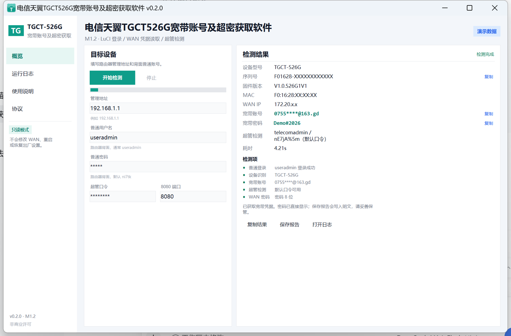

# 电信天翼TGCT526G宽带账号及超密获取软件（M1.2）

面向 **TGCT-526G 天翼网关** 的宽带账号及超密获取软件。M1.2 聚焦：

- 用路由器背面的普通账号登录 LuCI，读取宽带账号；
- 检测默认或自定义超管口令；
- 在超管可用时进入 8080 装维后台，从 WAN 页面解出 PPPoE 宽带密码；
- 记住上次目标、逐项复制、检测项清单、加密报告、预检和崩溃日志。

界面为浅色主题，Windows 便携版，带运行日志、结果复制/保存、使用说明和协议页。

> **M1.2 只读**：不保存 WAN、不重启、不恢复出厂、不开启 telnet、不写路由器文件。
> 工具不会爆破超管口令；如果口令已被修改，M1.2 会明确提示并停止。



## M1.2 新增

- 记住上次管理地址、普通用户名和 8080 端口；
- 可填自定义超管口令和装维端口；
- 宽带账号/密码/序列号逐项“复制”；
- 检测项清单：登录、设备识别、宽带账号、超管检测、WAN 密码；
- 加密报告（`.tgct`，AES-256-GCM + 密码），同时保留 JSON/文本；
- 启动预检 80/8080 端口，GET 请求失败自动重试一次；
- 日志轮转（保留最近 20 份）和崩溃日志；
- 错误提示带下一步建议，不再只抛出异常。

## 下载与运行

1. 打开 [Releases](https://github.com/dellzou/tgct-526g-audit/releases/latest)。
2. 下载 `TGCT526G-Audit-0.2.0-win64.zip`。
3. 解压到任意目录，双击 `TGCT526G-Audit.exe`。Windows SmartScreen 可能提示“未知发布者”，选择“更多信息 → 仍要运行”。
4. 电脑连接到该路由器的 LAN 口或 WiFi。
5. 填写管理地址（默认 `192.168.1.1`）和路由器背面的普通账号。
6. 点击“开始检测”，在右侧查看结果。

> 这是便携版（onedir），解压即用，不往临时目录释放 DLL，启动更快，也更少被杀毒软件误报。
> 如果仍然被拦截，可下载源码用 `python -m tgct526g` 运行，或按下方步骤自行构建。

## 快速开始（源码）

```powershell
cd tgct-526g-audit
$env:PYTHONPATH = "src"
python -m tgct526g
```

需要 Python 3.10+，Tkinter（Windows 官方 Python 自带）。

## 命令行模式

```powershell
$env:PYTHONPATH = "src"
python -m tgct526g --cli --host 192.168.1.1 --user useradmin --password ni7tk `
  --ta-password nE7jA%5m --admin-port 8080 --out result.json
```

命令行默认隐藏密码；需要明文输出时加 `--show-secrets`。GUI 结果区直接显示密码。JSON 报告始终写入 `--out` 指定的文件。

## M1.2 功能

| 功能 | 说明 |
|---|---|
| 设备识别 | 型号、序列号、固件版本、MAC、WAN IP |
| 普通用户登录 | LuCI `sysauth` 会话，读取 `gwinfo?get=all` |
| 宽带账号 | `wanAcnt` 字段 |
| 超管检测 | 默认或自定义 TA 口令 + 可配置 8080 端口 |
| 宽带密码 | 解析 `NN_WAN.html` 的 `WanConnStr`，Base64 解码 |
| 交互 | 记住目标、逐项复制、检测项清单 |
| 可靠性 | 80/8080 预检、GET 重试、日志轮转、崩溃日志 |
| 日志 | 界面实时日志 + `%LOCALAPPDATA%\TGCT526G\logs` |
| 报告 | JSON / 文本 / 加密 `.tgct`（AES-256-GCM） |

## 不包含

- 超管口令爆破；
- 配置分区/PSI/NVRAM 提取；
- telnet/SSH 开启；
- FTP 路径穿越利用；
- 远程下载 RCE。

这些属于 M2.1/M3，默认不会包含在 M1.2 的发布物中。

## 构建 Windows exe

```powershell
python -m pip install pyinstaller pillow
powershell -NoProfile -ExecutionPolicy Bypass -File .\build.ps1
```

产物：

- `dist\TGCT526G-Audit-0.2.0-win64.zip`（GUI 便携版）
- `dist\tgct526g-cli-0.2.0-win64.zip`（命令行便携版）
- `dist\SHA256SUMS.txt`（发布包校验值）

## 开发与测试

```powershell
$env:PYTHONPATH = "src"
python -m unittest discover -s tests -v
```

## 工作原理（简述）

1. `GET /cgi-bin/luci` → `POST username/psd`，获得 `sysauth`；
2. `GET /cgi-bin/luci/admin/settings/gwinfo?get=all` 读取 `wanAcnt`；
3. 用 `telecomadmin / nE7jA%5m` 请求主登录页，若返回带 `psd` 的 8080 自动跳转脚本，说明 TA 口令有效；
4. `POST http://host:8080/login.cgi`（`username=telecomadmin&psd=...`，明文）进入 `/main.html`；
5. 读取 `/NN_WAN.html`，解析 `WanConnStr` 第 9/10 字段，Base64 解码密码。

## 许可

本项目采用 **电信天翼TGCT526G宽带账号及超密获取软件 非商业许可 1.0**：

- 允许个人、教育、研究、实验室环境使用；
- **禁止未经权利人书面许可的商业用途**；
- 分发需保留协议与版权声明；
- 按“现状”提供，无担保。

完整文本见 [LICENSE](LICENSE)，软件内“协议”页也可查看。

## 免责声明

本工具仅用于自有设备、实验室环境或明确获准的安全评估。使用者应遵守当地法律法规，
并自行承担使用风险。请勿把真实设备凭据、日志或报告提交到仓库。
